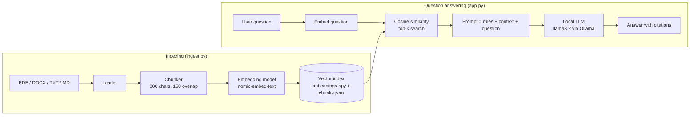

# DocBot: Offline Document Q&A Chatbot

A retrieval-augmented generation (RAG) chatbot that answers questions from your own
documents (PDF, DOCX, TXT, Markdown) **entirely offline**. The language model and the
embedding model both run locally through [Ollama](https://ollama.com), so no document text
or query ever leaves the machine, which makes it suitable for air-gapped or
security-sensitive environments.

Developed as part of a project at DRDO.


---

## Features

- **Fully offline**: local LLM + local embeddings via Ollama; no cloud APIs, no API keys
- **Grounded answers with citations**: every answer cites the file and page it came from
- **Refuses to guess**: says so when the answer isn't in the documents
- **Multi-format ingestion**: PDF (per-page citations), DOCX (incl. tables), TXT, MD
- **Conversation memory**: understands follow-up questions
- **Streamlit chat UI**: upload documents, rebuild the index and chat from the browser
- **Terminal mode**: `chat_cli.py` for headless servers
- **Lightweight**: no LangChain / vector-DB server; a NumPy index stored as two files
- **Tested**: unit and end-to-end tests run in CI without needing a model server

## Architecture



## Project structure

```
drdo-docbot/
├── app.py                  # Streamlit chat interface
├── ingest.py               # CLI: build the index from data/docs
├── chat_cli.py             # CLI: chat in the terminal
├── docbot/
│   ├── config.py           # Settings (overridable via .env)
│   ├── loader.py           # PDF / DOCX / TXT / MD text extraction
│   ├── chunker.py          # Boundary-aware overlapping chunking
│   ├── llm.py              # Ollama client (embeddings + streaming chat)
│   ├── vectorstore.py      # NumPy cosine-similarity index
│   └── rag.py              # Indexing + retrieval + grounded generation
├── data/
│   ├── docs/               # Put your documents here (git-ignored)
│   └── index/              # Generated index (git-ignored)
├── tests/                  # pytest suite (uses a fake Ollama client)
├── .env.example
└── requirements.txt
```

## Setup

### 1. Install Ollama and pull the models

Download Ollama from <https://ollama.com/download>, then:

```bash
ollama pull llama3.2:3b        # chat model (~2 GB)
ollama pull nomic-embed-text   # embedding model (~270 MB)
```

> On a low-RAM machine, try `llama3.2:1b`. With a good GPU, `llama3.1:8b` or
> `qwen2.5:7b` give better answers. Set `CHAT_MODEL` in `.env`.

### 2. Install the Python app

```bash
git clone https://github.com/<your-username>/drdo-docbot.git
cd drdo-docbot
python -m venv .venv
source .venv/bin/activate          # Windows: .venv\Scripts\activate
pip install -r requirements.txt
cp .env.example .env               # Windows: copy .env.example .env
```

### 3. Add documents and build the index

Copy your files into `data/docs/` (a sample safety manual is included), then:

```bash
python ingest.py
```

### 4. Run

```bash
streamlit run app.py
```

Open <http://localhost:8501>. You can also upload documents and rebuild the index from the sidebar.

Or chat in the terminal:

```bash
python chat_cli.py
```

### Example (with the sample document)

> **Q:** Can interns work late in the lab?
> **A:** Interns may work only between 09:00 and 17:30 on working days, unless the
> Laboratory In-charge gives written permission for extended hours [1].
> *Sources: [1] sample_lab_safety_manual.md*

## Configuration

All settings live in `.env` (see `.env.example`):

| Variable | Default | Description |
|---|---|---|
| `CHAT_MODEL` | `llama3.2:3b` | Ollama model used to write answers |
| `EMBED_MODEL` | `nomic-embed-text` | Ollama embedding model (rebuild index if changed) |
| `CHUNK_SIZE` / `CHUNK_OVERLAP` | `800` / `150` | Chunk length and overlap in characters |
| `TOP_K` | `4` | Number of chunks given to the LLM as context |
| `MIN_SCORE` | `0.25` | Minimum cosine similarity for a chunk to count as relevant |
| `TEMPERATURE` | `0.1` | Lower = more factual, less creative |

## Running in an air-gapped network

1. On an internet-connected machine, install Ollama and pull the models, and run
   `pip download -r requirements.txt -d wheels/`.
2. Copy the Ollama installer, the `~/.ollama/models` folder, the `wheels/` folder and this
   repo to the offline machine.
3. Install with `pip install --no-index --find-links wheels/ -r requirements.txt`.

The app binds to `localhost` only by default (`.streamlit/config.toml`).

## Testing

```bash
pip install -r requirements-dev.txt
pytest -q
```

Tests use a deterministic fake model client, so they run without Ollama (also in GitHub Actions).

## Security note

**Do not commit real project documents or the generated index to GitHub.**
`data/docs/*` and `data/index/` are git-ignored for this reason; only the fictional
sample document is tracked. Follow your organisation's rules on what may be published.

## Possible extensions

- OCR for scanned PDFs (Tesseract)
- Hybrid search (BM25 + embeddings) and re-ranking
- Hindi / multilingual documents with a multilingual embedding model
- User authentication and per-user document collections
- Answer evaluation on a set of reference questions

## License

MIT, see [LICENSE](LICENSE).
